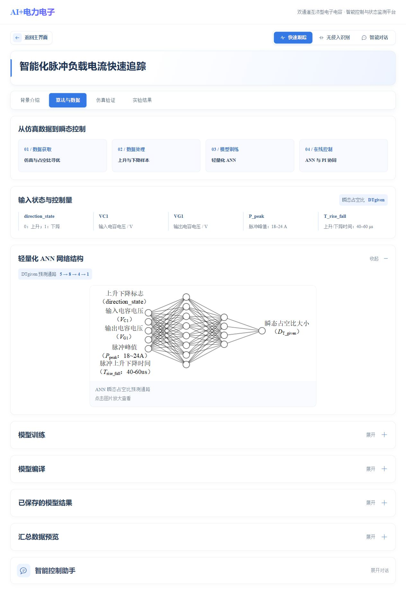
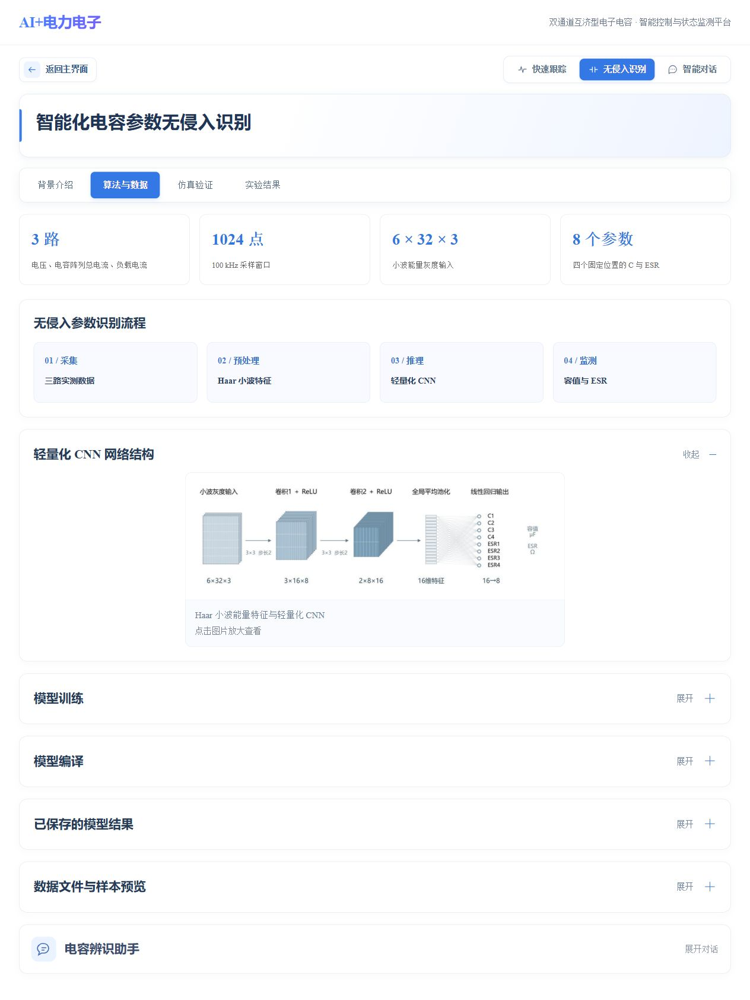
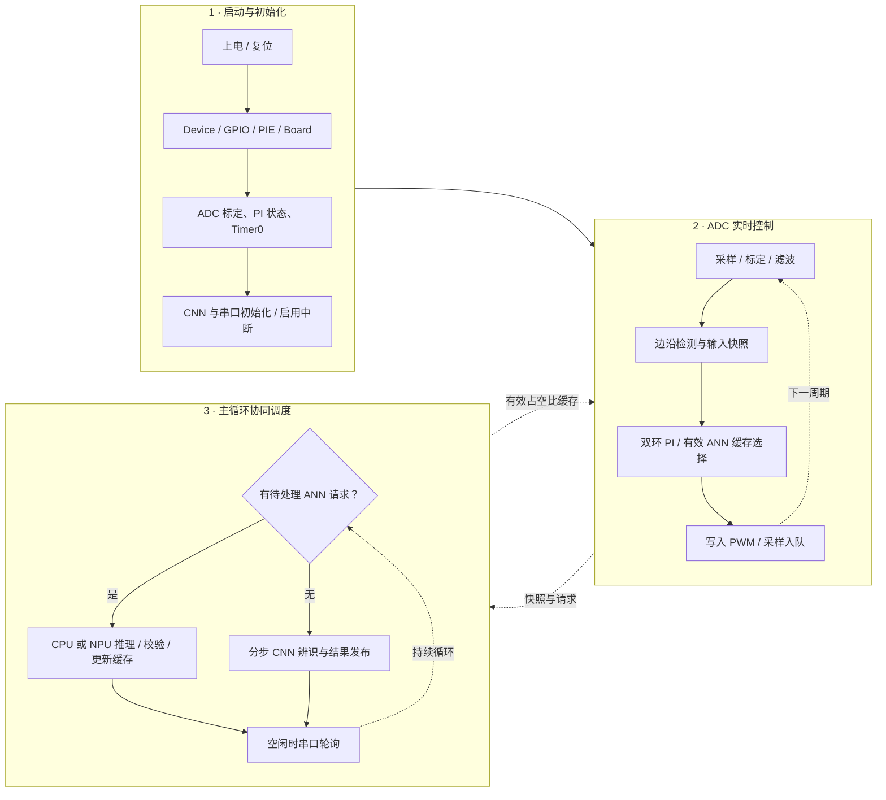
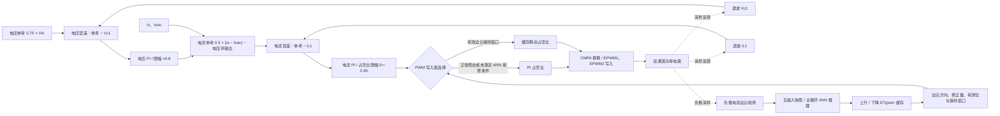

<div align="center">

# Electronic_Capacitor_Platform

**脉冲平抑系统强瞬变电流高精度跟踪控制与电容阵列单体参数辨识**

将数据、算法、仿真与硬件监测连接在同一个研究界面中。

[](https://github.com/zhouyingjie-111/Electronic_Capacitor_Platform/actions/workflows/check.yml)
[](requirements.txt)
[](#快速开始)
[](LICENSE)

[功能概览](#功能概览) · [界面预览](#界面预览) · [快速开始](#快速开始) · [使用指南](#使用指南) · [开发与扩展](#开发与扩展)

</div>

## 项目概览

本项目围绕**双通道互济型电子电容**，提供从离线数据处理、模型训练与编译，到 Simulink 仿真和开发板串口监测的完整工作入口。网页基于 Flask 构建，前端资源随源码提供，无需安装 Node.js 或执行前端构建。

| 强瞬变电流跟踪控制 | 电容阵列单体参数辨识 |
| :--- | :--- |
| 轻量化 **ANN 与 PI 协同控制**，学习状态量与瞬态占空比之间的映射。 | **Haar 小波与轻量化 CNN** 结合，从运行信号中提取辨识特征。 |
| 面向脉冲负载的上升、下降过程，提供训练、编译、控制仿真与在线监测入口。 | 面向四个固定位置电容，估计单体容值 **C** 与等效串联电阻 **ESR**。 |

两条研究路线共用数据管理、串口连接和智能对话能力，并分别提供背景介绍、算法与数据、仿真验证、实验结果四个页面。

## 功能概览

| 功能 | 可以完成的操作 |
| :--- | :--- |
| **数据与模型训练** | 使用默认数据或上传自己的数据；查看数据预览、训练进度和日志；下载训练产物。 |
| **模型编译** | 训练与编译独立操作；快速追踪支持 CPU / NPU 编译入口，电容辨识提供配套编译流程；完成后下载结果。 |
| **Simulink 仿真** | 打开对应模型、修改参数、运行仿真，查看模型画面、仿真进度和示波器波形。 |
| **串口监测** | 共享开发板连接，显示电压、电流、负载、推理耗时等接收数据；电容辨识可通过“开始辨识”触发采集。 |
| **智能对话** | 接入 DeepSeek、豆包、Kimi、千问；提供通用电力电子助手和研究对象专用助手，支持附件、历史与文件下载。 |
| **数据维护** | 对 InputData / OutputData 进行文件统计、预览、编辑、导入导出和清理。 |

> 基础网页可独立启动。模型训练、仿真、目标编译和开发板通信分别需要相应的软件环境或硬件；它们不会在打开网页时自动运行。

## 界面预览

### 平台首页

三个入口分别对应快速追踪、电容参数识别和智能对话。


<details>
<summary><strong>查看快速追踪 · 算法与数据页面</strong></summary>

输入状态、ANN 结构、模型训练、模型编译及数据预览按模块组织，可分别展开。



</details>

<details>
<summary><strong>查看电容参数辨识 · 算法与数据页面</strong></summary>

从三路实测数据到小波特征、CNN 推理和单体参数监测，保留独立的训练与编译入口。



</details>

## 快速开始

### 1. 获取项目

在仓库页面选择 **Code → Download ZIP** 并完整解压，或执行：

```powershell
git clone https://github.com/zhouyingjie-111/Electronic_Capacitor_Platform.git
cd Electronic_Capacitor_Platform
```

当前维护环境为 **Windows x64 + Python 3.10（64 位）**。使用 VS Code 调试时，安装 Microsoft 的 Python 与 Python Debugger 扩展。

### 2. 安装并启动

首次使用双击 **`安装依赖.bat`**，安装完成后双击 **`启动网页.bat`**。安装脚本会创建 `.venv`，优先使用仓库内的离线依赖包，并执行页面与资源自检。

也可在项目根目录的 PowerShell 中手动运行：

```powershell
py -3.10 -m venv .venv
.\.venv\Scripts\python.exe -m pip install --no-index --find-links=wheels -r requirements.txt
.\.venv\Scripts\python.exe run.py
```

如未下载 `wheels`，将安装命令替换为：

```powershell
.\.venv\Scripts\python.exe -m pip install -r requirements.txt
```

浏览器会自动打开。默认地址为 **`http://127.0.0.1:5001/`**；端口被占用时会选择附近可用端口，实际地址以终端输出为准。在启动终端按 `Ctrl+C` 停止服务。

### 3. 在 VS Code 中运行

打开整个项目文件夹或 `电子电容平台.code-workspace`，按 **F5**，选择 **“启动电子电容平台”**。首次调试前仍需安装依赖。

<details>
<summary><strong>检查环境，或在不自动打开浏览器的情况下启动</strong></summary>

```powershell
# 检查依赖、主要页面、静态资源与默认数据
.\.venv\Scripts\python.exe run.py --check

# 仅启动服务，手动访问终端输出的网址
.\.venv\Scripts\python.exe run.py --no-browser
```

修改 Python 源码后停止并重新启动服务；修改页面样式或脚本后刷新浏览器。工程使用相对路径，可整体移动；文件夹名称为 `Electronic_Capacitor_Platform`。

</details>

## 使用指南

### 快速追踪：数据 → 训练 → 编译

1. 进入 **快速追踪 → 算法与数据**，展开“模型训练”。
2. 选择默认数据或上传 CSV，在“汇总数据预览”中检查当前选择的数据。
3. 开始训练并查看日志，完成后下载模型。
4. 展开“模型编译”，选择 **CPU 模型编译** 或 **NPU 模型编译**。
5. 使用本次训练输出或上传兼容模型，编译完成后下载结果。

页面展示的目标控制量为瞬态占空比 **DTgiven**。CPU / NPU 编译产物的使用条件不同，请同时查看页面中的模型文件要求和编译要求；NPU 加速效果需在目标开发板上实测。

<details>
<summary><strong>自定义 ANN 训练数据格式</strong></summary>

上传 CSV 最大 **20 MB**、不超过 **100000 行**，使用 UTF-8 或 GBK 编码。表头须包含：

```text
P_peak, T_rise_fall,
VC1_UP, VG1_UP, VC1_DOWN, VG1_DOWN,
D_T_UP_given, D_T_DOWN_given, PWM_S_UP_first, PWM_S_DOWN_first
```

- 峰值电流单位为 A；`T_rise_fall` 单位为 s，例如 `50e-6` 表示 50 μs。
- 必要列不能包含空值、非数值或非有限数值；占空比须在 0～1 范围内。
- 至少提供 5 组不同的有效工况，用于划分训练、验证与测试集。
- 页面预览按当前范围显示 `T_rise_fall` 为 40～60 μs 的前 8 行，不显示仿真文件与编号列。

可先参考默认文件 [`仿真结果汇总.csv`](project_data/OutputData/仿真结果汇总.csv) 的组织方式。上传模型的结构和大小约束以页面校验提示为准。

</details>

### 电容辨识：信号 → 特征 → 参数

1. 进入 **无侵入识别 → 算法与数据**，选择默认示波器数据或上传数据 ZIP。
2. 检查“数据文件与样本预览”，按页面操作完成预处理和训练。
3. 训练完成后下载产物，再独立执行模型编译。
4. 在“实验结果”连接开发板，通过 **开始辨识** 触发采集，查看接收的状态与参数。

默认流程使用电压、电容阵列总电流和负载电流三路信号；采样窗口为 1024 点，小波特征输入为 `6 × 32 × 3`，输出为四个固定位置电容的 C 与 ESR。

自定义数据 ZIP 最大 **200 MB**；请按页面文件要求组织波形及标签。配套代码与配置位于 [`project_data/Code/python/scope_cap`](project_data/Code/python/scope_cap)。

### 仿真验证

在对应功能的“仿真验证”页选择模型、设置仿真时间和参数，再打开或运行模型。快速追踪提供 PI、ANN、自定义控制三种入口；电容辨识使用独立的 CNN 仿真模型。

运行后可查看进度和示波器波形。快速追踪提供“电压”“电流”“开关”和“追踪情况”四个示波器入口。**仅查看模型时不会启动仿真**；快速追踪的已有仿真记录可独立展开。

### 串口通信

进入“实验结果”并展开串口通信，选择 **XDS110 Application/User UART**。配套固件默认使用 **115200 baud、8N1**。

快速追踪与电容辨识共用一个后端串口连接，页面切换时保持连接状态；显示值和曲线来自实际接收的数据。电容辨识的“开始辨识”发送配套协议中的 `CAPTURE` 指令。

使用前需在开发板烧录匹配的配套固件，并释放其他软件对同一串口的占用。

### 智能对话与数据维护

- **智能对话**：选择提供商，输入自己的 API Key，再选择模型。首页助手面向电力电子领域，功能页助手分别针对快速追踪与电容辨识；可粘贴图片、上传文件并下载生成的文件。附件能力取决于所选模型与接口。
- **对话历史**：保存在本机运行目录，按当前 Windows 账户加密；更换电脑或账户时不能假定原历史可以直接解密。
- **数据维护**：从首页进入，仅管理 `project_data/InputData` 与 `OutputData`。执行编辑、导入或删除前，先备份需要保留的数据。

## 环境与配置

| 要使用的功能 | 需要准备的环境 |
| :--- | :--- |
| 浏览网页、数据预览、串口入口、智能对话入口 | Python 3.10 与 `requirements.txt` 中的基础依赖 |
| ANN / CNN 数据处理与训练 | `requirements-training.txt` 中的依赖，可使用独立虚拟环境 |
| Simulink 模型与示波器 | MATLAB、Simulink、模型依赖产品，以及与所用 Python 兼容的 MATLAB Engine |
| TI 模型编译 | 对应目标的 TI 工具链；NPU 编译另需 TI MCU NNC 及配套量化环境 |
| 开发板串口监测 | 配套开发板、匹配固件与串口驱动 |
| 在线大模型对话 | 对应提供商的 API Key、模型访问权限及网络连接 |

基础网页与训练环境分开管理，便于保留不同工具各自的依赖版本。离线 `wheels` 仅包含基础网站所需依赖。

<details>
<summary><strong>本机配置项与外部工具接入</strong></summary>

将 [`config.example.json`](config.example.json) 复制为 `config.json` 后按需填写。**环境变量优先于本机配置，相对路径以项目根目录为基准。** 默认启动网页无需修改配置。

| 选项 | 作用 |
| :--- | :--- |
| `HOST` / `PORT` | 监听地址与首选端口，默认 `127.0.0.1` / `5001` |
| `DELTA_PROJECT_ROOT` | 数据工程目录，默认 `project_data` |
| `ANN_PYTHON` / `CAP_PYTHON` | ANN / CNN 任务解释器；未设置时使用启动网站的 Python |
| `MATLAB_ROOT` | 本机 MATLAB 安装目录 |
| `TI_CGT_ROOT` | TI C2000 编译器根目录，含 `bin/cl2000.exe` |
| `CAP_CLANG` / `CAP_CL2000` | CNN 核验及目标编译所用编译器的完整路径 |

安装训练依赖时，在相应环境中执行：

```powershell
python -m pip install -r requirements-training.txt
```

MATLAB Engine 需根据本机 MATLAB 版本安装到调用它的 Python 环境。TI MCU NNC、CCS、C2000Ware、SysConfig 等专用工具需单独安装。

CPU / NPU 控制工程与导入步骤见下方“DSP 控制工程”。仓库中的 `mod.a` 为对应模型库输入，不能当作缓存删除，也不能在两套工程间直接混用。网页不自动烧录开发板。

</details>

## DSP 控制工程

| 工程 | ANN 推理实现 | CNN 参数辨识 | 工程入口 |
| :--- | :--- | :--- | :--- |
| **CPU 版本** | CPU 执行配套模型库，控制侧取输出 `[0]` 作为 DTgiven | CPU 后台分步执行 | [`PI_ANN_CNN_SCI_CPU`](https://github.com/zhouyingjie-111/Electronic_Capacitor_Platform/tree/main/firmware/PI_ANN_CNN_SCI_CPU) |
| **NPU 版本** | NPU 执行配套 ANN，CPU 负责输入归一化、完成处理与结果反归一化 | 仍由 CPU 后台分步执行 | [`PI_ANN_CNN_SCI_NPU`](https://github.com/zhouyingjie-111/Electronic_Capacitor_Platform/tree/main/firmware/PI_ANN_CNN_SCI_NPU) |

两套工程保留附件中的控制源文件、模型库、链接脚本、SysConfig 与 CCS 工程配置；不收录构建输出和编辑器缓存。原有 [`PI_ANN_CNN_SCI_Web_Monitor`](firmware/PI_ANN_CNN_SCI_Web_Monitor) 保留为先前串口监测工程。

### 导入与运行

1. 在 CCS 中导入需要的 CPU 或 NPU 工程，选择 **`CPU1_FLASH`** 构建配置。
2. 确认目标器件为 **TMS320F28P550SJ9**，配置本机 C2000Ware、SysConfig 和 C2000 编译器。附件配置记录的 C2000Ware 产品版本为 **26.1.0.00**，编译器工具链系列为 **25.11**；实际安装路径需与本机环境一致。
3. 由 `c2000.syscfg` 重新生成板级文件，再构建工程。`driverlib.lib` 通过 C2000Ware 路径解析，`mod.a` 与 `tvmgen_default.h` 使用同一工程附带的一组文件。
4. 连接匹配的开发板，按原工程调试流程烧录并运行。电流、电压的偏置与增益以实际硬件标定为准；本仓库不把软件测试结果作为上板验证结论。
5. 启动网页，在“实验结果”选择对应串口，查看监测数据；需要辨识时点击“开始辨识”。

### 程序运行流程

ADC 中断执行采样、PI 更新与 PWM 写入，主循环优先处理 ANN 请求；没有待处理 ANN 请求时，再推进一小步电容辨识和串口轮询。



当前附件在滤波 `Vin ≥ 265 V` 后置位 `AnnStartEnable`。ANN 输入顺序为峰值电流、边沿时间、两路电压和上升/下降标志；对应 `g_nnInput[0..4]`。输入快照在边沿保存，主循环计算并更新缓存，实时中断不等待神经网络计算结束。

### 双环控制与 ANN 协同框图



图中 `Vc1`、`iL1` 等名称按源码结构字段表达。两套附件均持续更新 PI 状态，ANN 的接管发生在最终 `CMPA` 写入选择处；上升沿保持 2 次、下降沿保持 3 次 ADC 更新。两方向结果均有效且满足边沿条件时，才使用瞬态占空比缓存。

### 电容辨识与监测流程


此流程不修改 PWM 控制量。附件中的三路原始量使用 `ADC_Sample_Raw.Vs1`、`ic`、`io`，标定参数在启动辨识时从 `main.c` 定义的采样偏置与增益结构读取。网页名称、结构字段与物理接线需结合当前工程的实际通道映射理解，不应仅按变量缩写重新接线。

<details>
<summary><strong>CPU / NPU 的运行状态与耗时查看</strong></summary>

| 观察量 | 含义 |
| :--- | :--- |
| `g_nnReturnCode` / `g_nnTestState` | 最近一次 ANN 返回值与状态；正常完成时分别为 `0` / `2` |
| `g_nnSampleCount` | 已成功完成的 ANN 次数 |
| `g_nnTimeUs` / `g_annTimeUs` | 最近一次推理调用测得的耗时，包含调用期间控制中断抢占的影响 |
| `g_nnTimeFirstUs` / `g_nnTimeMinUs` / `g_nnTimeMaxUs` | 首次与历史最小、最大推理耗时 |
| `g_nnNpuInitOK` | NPU 版本硬件初始化状态 |
| `g_nnNpuIrqCount` / `g_nnNpuLastIrqDelta` | NPU 完成事件累计值与本次增量；当前配套 ANN 成功条件包含本次增量等于 `3` |
| `g_nnNpuFaultLatched` | NPU 版本故障锁存；错误后不自动改用 CPU 重新推理 |
| `g_capState` / `g_capFault` / `g_capValid` | 电容辨识状态、故障位与结果有效标志 |
| `g_capInferUs` / `g_capPreprocessUs` | 电容辨识累计推理与预处理耗时 |

NPU 版本通过 `ann_npu_adapter.c` 启动配套硬件模型；`nn_npu_platform.c` 注册 NPU 完成中断，ISR 记录事件，主循环调用辅助处理并检查完成状态。当前超时阈值为 1000 μs，超时或完成检查失败会记录故障。SCI 使用主循环轮询，不增加 SCI 收发中断；NPU 完成中断与控制中断并存，其实际时序影响需上板测量。

</details>

## 项目结构

```text
Electronic_Capacitor_Platform/
├─ run.py                       # 启动、端口选择与自检入口
├─ settings.py                  # 配置读取与路径规范化
├─ config.example.json          # 可共享的配置模板
├─ webapp/
│  ├─ templates/                # 页面模板
│  ├─ static/project/           # 样式、交互、图片及前端依赖
│  ├─ simulink_bridge/          # MATLAB / Simulink 桥接
│  ├─ tests/                    # 自动化回归测试
│  └─ *.py                      # 路由、训练、仿真、串口与对话服务
├─ project_data/
│  ├─ Code/python/              # ANN / CNN 与 CPU / NPU 编译脚本
│  ├─ InputData/                # 默认输入与示波器数据
│  ├─ OutputData/               # 汇总数据与已保存结果
│  └─ Simulink/                 # 仿真模型
├─ firmware/                    # CPU / NPU 与原有监测 CCS 工程
├─ wheels/                      # Windows / Python 3.10 离线基础依赖
├─ docs/images/                 # 真实界面预览
└─ .vscode/                     # 可共享的启动与调试配置
```

## 开发与扩展

| 修改方向 | 主要入口 |
| :--- | :--- |
| 页面、样式与交互 | `webapp/templates`、`webapp/static/project` |
| 路由与功能注册 | `webapp/app.py`、`webapp/project_portal.py` |
| 数据维护 | `webapp/database_routes.py`、`webapp/csv_data_manager.py` |
| ANN / CNN 训练任务 | `webapp/training_runner.py`、`webapp/capacitance_training.py` |
| 仿真、模型与波形 | `webapp/simulation_runner.py`、`webapp/scope_waveforms.py`、`webapp/simulink_bridge` |
| 串口协议与趋势图 | `webapp/serial_service.py`、`webapp/static/project/serial.js` |
| AI 提供商、流程与提示词 | `webapp/ai_providers.py`、`webapp/ai_service.py`、`webapp/ai_prompts.py` |
| 附件、文件下载与历史 | `webapp/ai_attachments.py`、`webapp/ai_files.py`、`webapp/ai_history.py` |

新增功能建议沿用“**路由校验 → 服务管理任务状态 → 外部工具执行**”的结构。长任务使用现有后台任务与日志查询机制；串口连接由共享服务统一维护；上传文件、任务结果与对话历史放入运行目录。

### 验证改动

```powershell
.\.venv\Scripts\python.exe run.py --check
.\.venv\Scripts\python.exe -m unittest discover -s webapp/tests -p "test_*.py" -q
```

[GitHub Actions](https://github.com/zhouyingjie-111/Electronic_Capacitor_Platform/actions/workflows/check.yml) 在 Windows / Python 3.10 下执行依赖安装、页面自检和回归测试。测试覆盖配置、上传与下载、任务状态、对话及数据维护等路径，不连接真实开发板、不调用收费 API，也不运行真实 MATLAB 或 TI 编译。历史 NPU 产物相关检查在缺少对应产物时会明确跳过。

欢迎通过 [Issues](https://github.com/zhouyingjie-111/Electronic_Capacitor_Platform/issues) 提交问题与建议。报告问题时请附上所处页面、操作步骤、Python / 工具版本及去除敏感信息后的错误日志。

<details>
<summary><strong>常见问题与本机文件</strong></summary>

| 情况 | 处理方式 |
| :--- | :--- |
| 提示找不到 Python 3.10 | 安装 64 位 Python 3.10 并包含 Python Launcher，或手动创建 `.venv`。 |
| 页面未自动打开 | 查看终端输出的网址并手动访问；先执行 `run.py --check` 排查依赖与资源。 |
| 训练、仿真或编译入口报环境错误 | 检查功能对应的软件是否安装，以及 `ANN_PYTHON`、`CAP_PYTHON` 和工具路径。 |
| 串口连接失败 | 检查驱动、端口、固件与波特率，并关闭其他占用该端口的软件。 |
| 修改代码后没有变化 | 重启 Python 服务，刷新页面；必要时清除浏览器中的旧静态资源缓存。 |

首次运行生成 `webapp/runtime`，其中包含上传内容、任务结果、对话历史和会话密钥。备份并停服后再清理需要保留的数据；`config.json`、`.venv`、运行目录和密钥均不应提交到仓库，`.gitignore` 已包含对应排除规则。

当前按本机研究工具使用，默认仅监听回环地址。若要部署为互联网多人服务，还需补充账户权限、部署隔离及外部工具访问控制。

</details>

## 许可证

项目自有源码和自有说明文档采用 **[MIT License](LICENSE)**。第三方组件、TI 支持文件、模型库及项目素材保留各自的许可与版权范围，详见 **[第三方组件说明](THIRD_PARTY_NOTICES.md)**。
